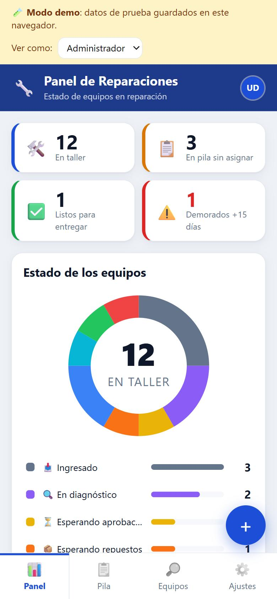
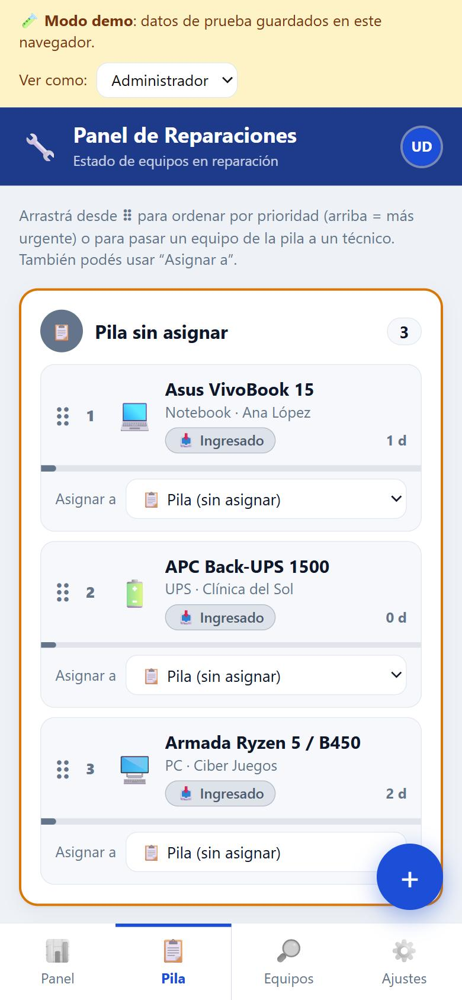
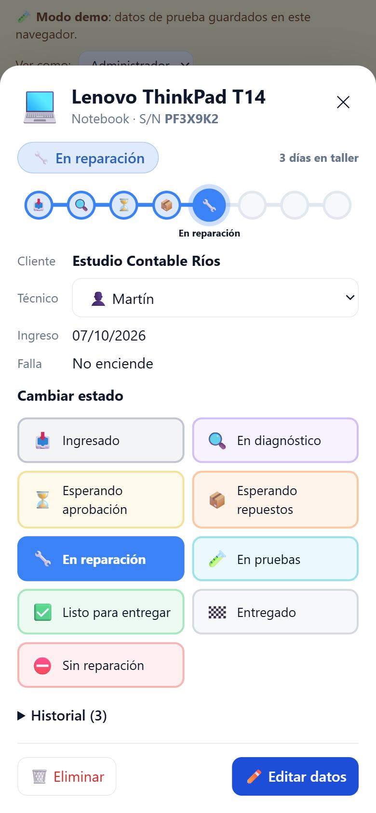
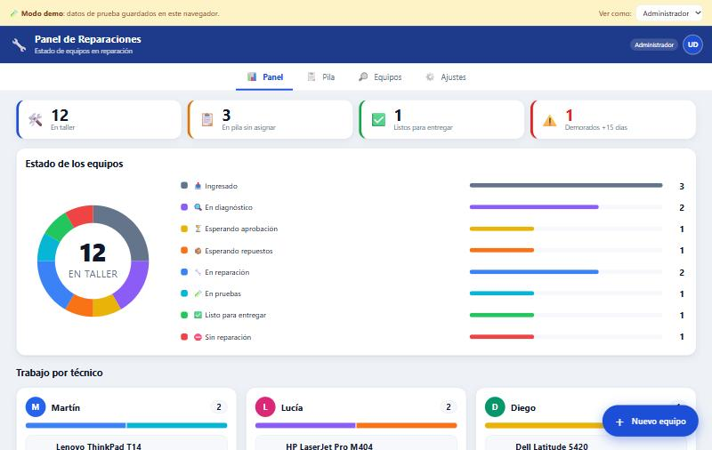

# 🔧 Panel de Reparaciones

Aplicación web para seguir en tiempo real el estado de los equipos en reparación de un servicio técnico: carga de equipos, asignación a técnicos, cola de prioridades y seguimiento visual del avance de cada reparación.

Nació de una necesidad concreta del taller donde trabajo. El responsable necesitaba ver **desde el celular**, de un vistazo, en qué estado está cada equipo y quién lo tiene asignado, y poder reorganizar las prioridades del trabajo sin depender de planillas ni mensajes.

**▶ Demo en vivo:** **https://USUARIO.github.io/REPO/** (datos de ejemplo, sin login; con el selector de arriba podés probar los distintos roles)

<p align="center">
  
  
  
</p>
<p align="center"></p>

## Funcionalidades

- **Panel gráfico**: indicadores (equipos en taller, sin asignar, listos, demorados), gráfico de dona por estado y la carga de trabajo de cada técnico con barras apiladas.
- **Pila de trabajo priorizada**: los equipos se ordenan arrastrando y se asignan a un técnico pasándolos a su cola. Funciona con mouse y en pantallas táctiles.
- **Seguimiento de cada equipo**: línea de pasos del proceso de reparación, días en el taller con alertas por demora e historial de cambios con quién hizo qué y cuándo.
- **Búsqueda y filtros** por cliente, marca, modelo, número de serie, estado o técnico.
- **Tiempo real**: los cambios aparecen al instante en todos los dispositivos, sin recargar.
- **Instalable**: se puede agregar a la pantalla de inicio del celular como si fuera una app.

## Roles y seguridad

El acceso es con cuenta de Google. Cada usuario tiene un rol:

| Rol | Puede |
|---|---|
| **Administrador** | Todo: cargar, editar y eliminar equipos, cambiar estados, asignar, priorizar, administrar técnicos y usuarios |
| **Supervisor** | Ver todo, asignar equipos a técnicos y reordenar la pila |
| **Solo lectura** | Ver todo |

Los permisos **se aplican en el servidor** con [reglas de seguridad de Firestore](firestore.rules), no solo ocultando botones en la interfaz. Por ejemplo, un supervisor puede modificar únicamente los campos de asignación y prioridad de un equipo (`affectedKeys().hasOnly(...)`). Cualquier otra escritura la rechaza la base de datos.

## Tecnologías

- **Frontend:** HTML, CSS y JavaScript sin frameworks ni paso de compilación (módulos ES nativos)
- **Backend:** Firebase Authentication (Google) + Cloud Firestore con caché offline persistente
- **Hosting:** Firebase Hosting (producción) y GitHub Pages con GitHub Actions (demo)
- **Librerías:** [SortableJS](https://github.com/SortableJS/Sortable) para arrastrar y soltar
- Diseño *mobile-first*, modo oscuro automático y gráficos en SVG hechos a mano

### Arquitectura

```
public/
  index.html
  css/estilos.css
  js/config.js   ← estados, tipos de equipo, alertas y credenciales públicas de Firebase
  js/data.js     ← capa de datos con dos implementaciones de la misma interfaz:
                   Firebase (producción) y localStorage (demo)
  js/app.js      ← estado, vistas, componentes y acciones
firestore.rules  ← control de acceso por rol
.github/workflows/demo-pages.yml  ← publica la demo en GitHub Pages
```

La capa de datos expone una interfaz única (`watch`, `add`, `update`, `batch`…) con dos implementaciones. Así la misma interfaz de usuario funciona contra Firestore o contra datos de demo locales, que se activan automáticamente sin Firebase configurado, en `github.io` o con `?demo` en la URL.

---

## Probarlo en la PC (modo demo)

```bash
node tools/servidor.mjs
```

Después abrí http://localhost:5173/?demo

---

## Publicarlo (gratis) con Firebase

### 1. Crear el proyecto
1. Entrá a https://console.firebase.google.com con tu cuenta de Google y tocá **Crear un proyecto**. Google Analytics no hace falta.
2. **Compilación → Authentication → Comenzar → Google →** habilitalo y guardá.
3. **Compilación → Firestore Database → Crear base de datos →** elegí una ubicación cercana (por ejemplo `southamerica-east1`) y empezá en **modo de producción**.
4. **⚙️ Configuración del proyecto → Tus apps →** ícono **`</>`** (Web), poné un nombre y registrala. Copiá el objeto `firebaseConfig` que te muestra.

### 2. Configurar el panel
1. En `public/js/config.js`:
   - Pegá los valores de `firebaseConfig` en `FIREBASE_CONFIG`.
   - Poné tu Gmail en `ADMIN_EMAILS`.
2. En `firestore.rules` reemplazá `TU_EMAIL@gmail.com` por **el mismo Gmail**.

### 3. Publicar
```bash
npx firebase-tools login
```
```bash
npx firebase-tools deploy
```

Al terminar te muestra la URL, del estilo `https://tu-proyecto.web.app`. **Ese es el link para tu jefe.**

> Requiere **Node 22 o más nuevo** (`winget install OpenJS.NodeJS.LTS`). Los comandos se ejecutan dentro de la carpeta del proyecto.

### 4. Dar acceso a tu jefe
1. Abrí el link, ingresá con tu Gmail y andá a **Ajustes**.
2. En **Usuarios con acceso**, agregá el Gmail de tu jefe con rol **Supervisor**.
3. En **Técnicos**, cargá los 5 técnicos (en el modo real empieza vacío).
4. Pasale el link. Ingresa una sola vez con Google y la sesión queda abierta en su celular.
   Con **“Agregar a pantalla de inicio”** le queda como una app más.

### Actualizar después de hacer cambios
```bash
npx firebase-tools deploy
```

---

## Personalizar
Todo está en `public/js/config.js`:
- `APP_NOMBRE`: el título del panel.
- `ESTADOS`: nombres, colores e íconos de los estados.
- `TIPOS`: tipos de equipo sugeridos.
- `DIAS_ALERTA`: a partir de cuántos días un equipo se marca en amarillo o en rojo.

Si agregás o quitás un administrador fijo, cambialo en `config.js` **y** en `firestore.rules`, y volvé a publicar.

## Estructura
```
public/            lo que se publica
  index.html
  css/estilos.css
  js/config.js     configuración
  js/data.js       conexión a Firebase / modo demo
  js/app.js        interfaz
firestore.rules    permisos de la base de datos
firebase.json      configuración de hosting
tools/servidor.mjs servidor local para pruebas
```
